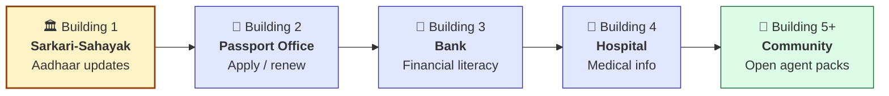
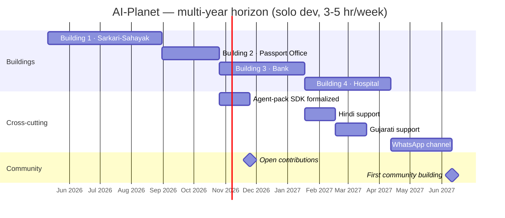

# AI-Planet — Master Roadmap

*Last updated: 2026-05-08*

> The long, unified plan. AI-Planet is built **one building at a time**. Each building is a specialist AI agent for a real-world domain. Sarkari-Sahayak is **Building 1** — its detailed phase plan lives at [`./sarkari-sahayak/ROADMAP.md`](./sarkari-sahayak/ROADMAP.md).

---

## Vision

A virtual town where every building is a specialist agent. Walk into the right one and get precise, cited, current help — for tasks generic chatbots botch and Google buries.

The town isn't (yet) a 3D game. It's a mental model and a UI metaphor. The real product is the **collection of specialist agents** + **the platform that makes adding one easy**.

## Long-term success criteria

- 5+ buildings live and used by real people
- 3+ buildings contributed by people other than the founder
- A clear, simple agent-pack format that a developer can ship in a weekend
- A real user base, not a demo

---

## Building order at a glance

---

## The buildings (planned)

### 🏛️ Building 1 — Sarkari-Sahayak (Aadhaar Office) · IN PROGRESS

The Aadhaar updates agent: mobile, address, name, photo. Proves the architecture, RAG pipeline, OSS workflow, and "real users" thesis.

**Detailed plan:** [`./sarkari-sahayak/ROADMAP.md`](./sarkari-sahayak/ROADMAP.md)
**Visuals:** [`./sarkari-sahayak/ROADMAP_VISUAL.md`](./sarkari-sahayak/ROADMAP_VISUAL.md)
**Estimated v1.0:** ~2026-08-30 (16 weeks at 3-5 hr/week)

### 🛂 Building 2 — Passport Office · NEXT

Apply, renew, tatkal, address change in passport, police verification flow.

**Why second:** Same domain (gov processes) → architecture reuse. Should be ~6-8 weeks because the agent framework, RAG pipeline, and OSS workflow are already built. This is the test of "does the platform make adding a building easy?"

**Output of this phase:** the **agent-pack format** crystallizes here. After Building 2 is live, a third party should be able to ship Building N by writing a new pack.

### 🏦 Building 3 — Bank

Banking jargon explainer, loan EMI math, fraud detection cues, RBI complaint procedures, scheme awareness (PMJDY, etc.).

**Why third:** First non-government domain. Tests whether the platform truly generalizes. Different data sources (RBI docs, bank policy pages) and different question shapes.

### 🏥 Building 4 — Hospital / Clinic

OPD navigation, ABHA setup, government health scheme eligibility, vaccine schedules, basic first-aid (with strong disclaimers).

**Why fourth:** Medical = sensitive. Tests our citation/safety guardrails seriously. This is where we formalize the "I'm not a doctor" pattern across all future health-adjacent agents.

### 🌱 Building 5+ — Community-driven

Once the agent-pack format is stable, we publish `CONTRIBUTING.md` and a "build your first building" guide. From here, anyone can ship a building. Likely candidates from the community:

- 💻 IT Firm — coding help, debugging
- 🌾 Farmer's Office — crops, weather, MSP
- 🏫 School — homework, exams, scholarships
- 🏠 Real Estate — rental laws, RERA, society norms
- 📡 Telecom Office — TRAI complaints, DND
- 🏪 Town Hall — Surat-specific civic processes

---

## Cross-cutting tracks (run in parallel with buildings)

These don't gate buildings; they layer on top.

| Track | Earliest start |
|---|---|
| Plugin SDK / agent-pack format | After Building 2 (matures from solving B2's reuse problem) |
| Multilingual (Hindi, then Gujarati) | After Building 3 |
| WhatsApp / voice channels | After Building 4 |
| Visual "town" UI (the literal AI-Planet map) | Last — purely cosmetic; only when there's enough to walk around |

---

## Time horizon

Solo dev at 3-5 hr/week. Realistic, not optimistic:

This will accelerate dramatically if contributors join. That's the whole point of OSS.

---

## Where we are now

**Building 1 · Sarkari-Sahayak · Phase 0 (Foundations)** — not yet started as of 2026-05-08.

Next concrete action: start Phase 0 of the Sarkari-Sahayak roadmap (install Ollama + scaffold Next.js).

---

## Principles (apply to every building, forever)

1. **Citations are non-negotiable.** Every claim links to source.
2. **"I don't know" beats "I'll guess."** Honest uncertainty + the official link.
3. **One building works brilliantly before the next.** No half-built buildings.
4. **The platform must make adding a building easy.** If not, refactor before scaling.
5. **Real users, not demos.** At least one real user per building before it counts as shipped.
6. **Free / local first.** Anyone runs it without paying for APIs.

## What AI-Planet is NOT

- A general-purpose chatbot (that's ChatGPT)
- A 3D game (the "town" is a metaphor; the visual map is optional)
- A SaaS product (open source first; hosted offering, if ever, comes later)
- A perfect AI (we're bounded by current LLMs and use retrieval to ground them)

---

*Edit this roadmap when reality diverges. The plan adapts; the principles don't.*
