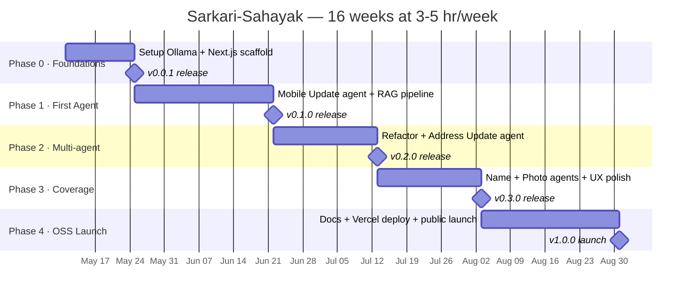
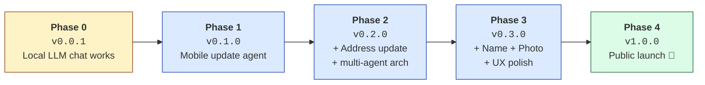
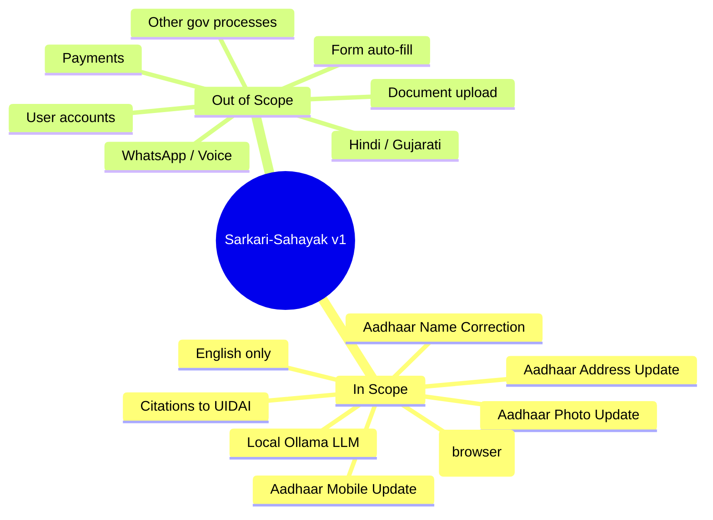
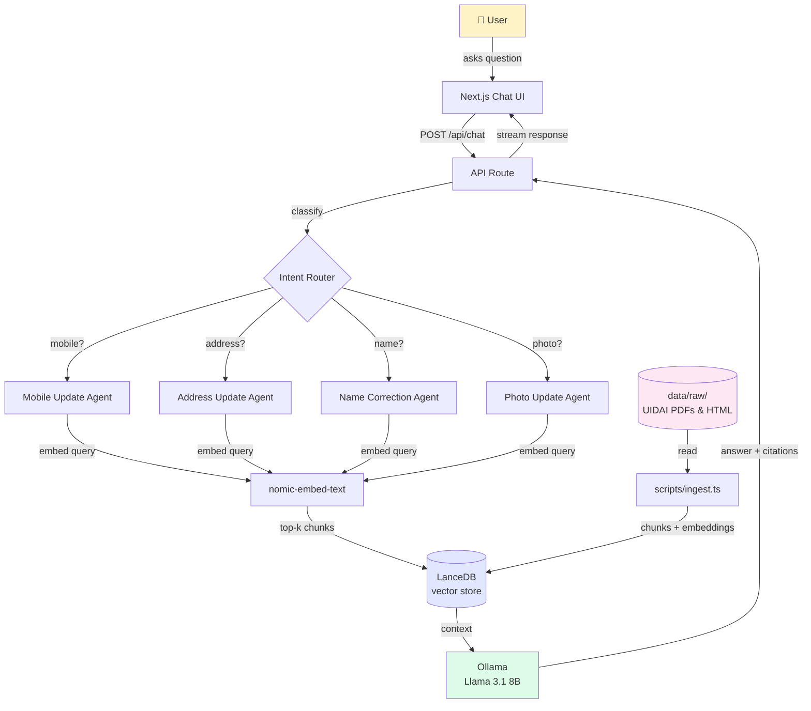
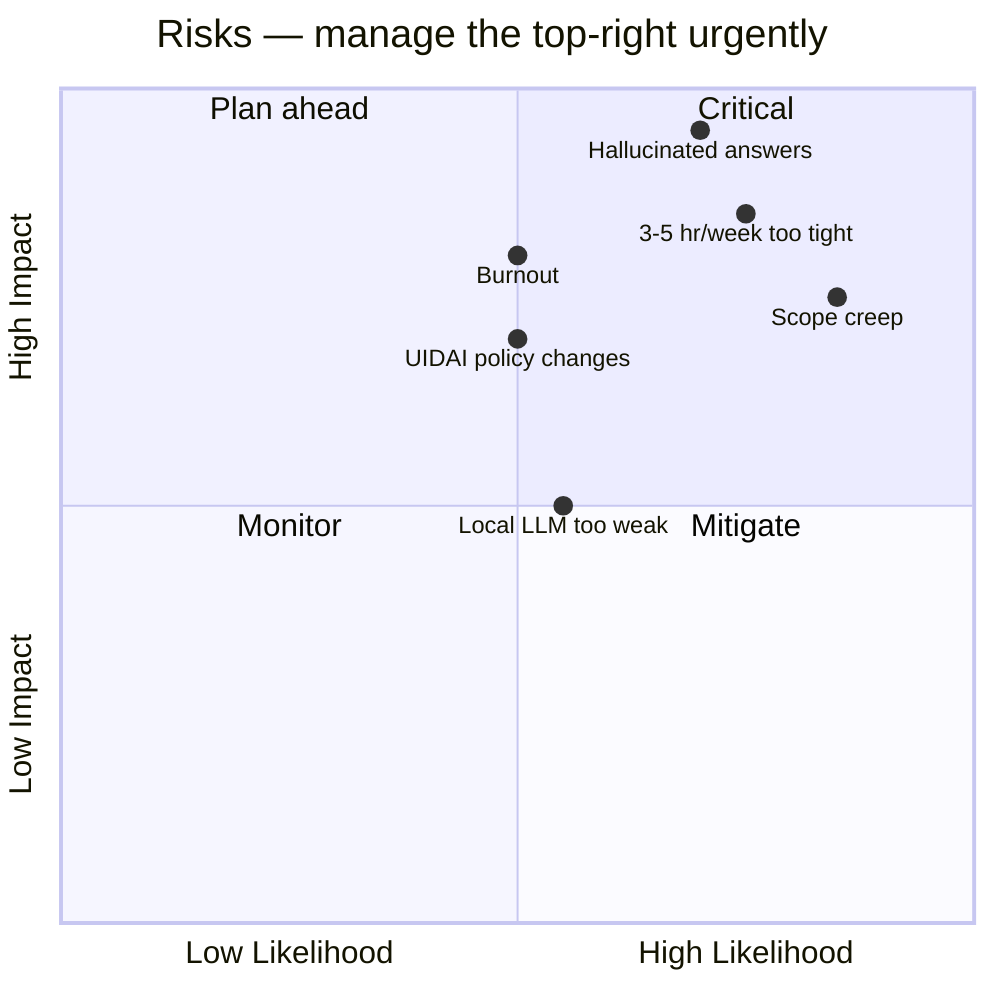

# Sarkari-Sahayak — Visual Roadmap

> Visual companion to [ROADMAP.md](./ROADMAP.md). All diagrams are Mermaid — they render natively on GitHub.

---

## Timeline (Gantt)

**Estimated finish:** ~2026-08-30 (assuming you start 2026-05-11 and stay on pace)

---

## Phase progression (release tags)

---

## What's in vs. out for v1

---

## System architecture (target)

---

## Risk × Time map

---

*Edit these diagrams when reality diverges from the plan. Keep this in sync with [ROADMAP.md](./ROADMAP.md).*
